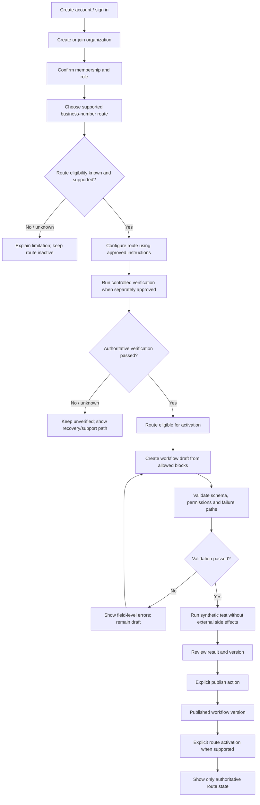
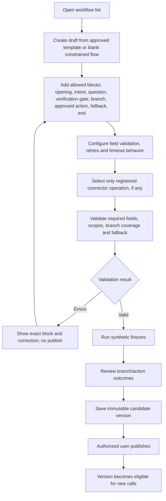
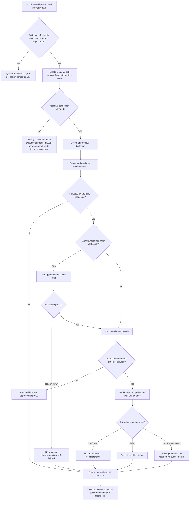

# Business Phone Assistant UX Wireflows — Draft

**Status:** Textual UX discovery draft only. Not validated with customers and not approved for implementation.  
**Date:** 2026-10-13.  
**Depends on:** `BUSINESS_PHONE_ASSISTANT_PRODUCT_DIRECTION.md`, `BUSINESS_ASSISTANT_DOMAIN_CONTRACT_DRAFT.md`, `BUSINESS_ASSISTANT_REQUIREMENT_GAP_AUDIT.md`, `UX_SCREEN_INVENTORY.md`.

## 1. Design intent and limits

The primary hypothesis is a business-configured inbound phone assistant. The business user configures a bounded workflow; callers interact over a route whose capabilities must be verified; authorized staff review call outcomes and confirmed actions.

This wireflow is not a final MVP or proof of demand. The initial target segment, route/provider, first workflow, connector, caller verification policy, legal requirements, language support and pricing remain undecided. No screen may imply support for missed-call capture, human handoff, customer lookup, ticket creation, recording or transcript unless the relevant capability and policy are approved.

## 2. Navigation model candidate

- **Overview:** service/route state, recent calls, workflow health and usage with source/freshness labels.
- **Calls:** inbox, filters, call detail, event provenance, workflow result and action outcome.
- **Workflows:** list, draft editor, validation, synthetic test, version history, publish/pause/retire.
- **Integrations:** configured server-registered connector, authorization scope, connection health and action reconciliation.
- **Team & access:** organization membership and roles after the role model is approved.
- **Usage & plan:** measured usage, limits, update delay and reconciliation state.
- **Privacy & operations:** notices/policies, retention/deletion status, support and urgent operational actions.

This is a candidate information architecture. Do not treat the list as an approved screen commitment.

## 3. Business admin onboarding

### Onboarding invariants

- Creating an account or organization does not make a route active.
- A successful route test does not publish a workflow; a published workflow does not prove a route is active.
- Unknown/unsupported route capability stays inactive and visibly unresolved.
- Synthetic workflow testing must not create real tickets or external side effects by default.
- Publishing requires an authorized organization role and immutable version/audit record.
- If no verified route exists, the user may continue exploring drafts but must not be told the assistant is handling live calls.

## 4. Workflow builder candidate flow

The editor must not accept arbitrary scripts, SQL, URLs, executable tools or instructions that grant permissions. Model-generated suggestions, if ever added, are untrusted drafts until schema validation and authorized publication. Caller input must not rewrite workflow configuration or connector permissions.

## 5. Caller interaction and call result

### Caller flow constraints

- If the call was not observed, the assistant cannot claim to know it occurred.
- An incoming-call event is not proof the assistant connected.
- AI disclosure wording/trigger and verification steps require policy review for the deployment jurisdiction.
- Caller ID can support matching but cannot, by itself, unlock protected customer details.
- Do not ask for or retain sensitive information unless the approved workflow and data policy require it.
- Connector actions are server-authorized and constrained; model confidence does not replace authorization.
- A request accepted by a connector is not necessarily a completed side effect.
- Caller abandonment, route/provider failure, assistant failure, action failure and unknown observation are distinct states.

## 6. Call inbox and detail

### Inbox row candidate fields

- Business-visible call/session reference and event-time range.
- Outcome label with evidence/source qualifier when needed.
- Workflow name/version where known.
- Action state: not requested, pending, confirmed, failed or unknown/reconciliation required.
- Data availability: summary available, processing, unavailable, expired or deleted.
- Freshness or reconciliation indicator for late/missing provider events.

Avoid showing raw phone numbers or caller identity in list rows by default until role and privacy policies define a need. Avoid a single “missed calls” count when source coverage is incomplete.

### Call detail sections

1. **Observed timeline:** events with source and event/receive timestamps where safe.
2. **Workflow outcome:** version, reached branch, collected fields and uncertainty.
3. **Connector actions:** operation, permitted input summary, authoritative result/reference, retries and reconciliation state.
4. **Review:** corrections to supported structured fields, attributed to the reviewer; do not silently overwrite source events.
5. **Data controls:** availability/retention state for summary, transcript and audio separately.

### Empty, partial and uncertain states

- **No observed calls:** say “No calls observed in this period” only with the metric's defined source coverage; otherwise say coverage is unknown.
- **Unknown outcome:** explain that evidence is incomplete or conflicting; do not classify as success.
- **Action pending:** show pending/reconciliation status and next safe step; do not invent a ticket number.
- **Deleted/expired artifact:** do not provide stale media links or imply other targets have been deleted unless the deletion contract confirms it.
- **Provider outage:** show impacted functionality and last known state; do not claim normal handling.

## 7. Roles and high-impact controls

Role labels and permission boundaries remain provisional. The final UX must make these distinctions explicit:

| Action | Required UX safeguard |
| --- | --- |
| Invite/remove member or change role | Show organization scope, consequence, confirmation and audit outcome. |
| Publish workflow | Show immutable version/diff, validation result, connector scopes and who is publishing. |
| Pause workflow | Label as stopping new workflow admissions according to the approved state contract; do not claim route disabled. |
| Disable phone route | Show route-specific consequences and distinguish requested, pending, confirmed and unverified state. |
| Configure connector | Show approved operation/scope and connection status; never expose secrets or arbitrary endpoint entry. |
| Export/delete data | Re-authenticate where required; show target-level progress and unresolved exceptions. |
| Resolve unknown action | Reconcile with the system of record; do not let a user simply mark a side effect successful without evidence. |

## 8. UX acceptance checks to add after baseline review

The following are proposed design checks, not executed usability tests:

- Admin can distinguish account setup, organization membership, workflow publication and route activation.
- User can identify which workflow version handled a call.
- Caller verification failure cannot lead to protected disclosure/action.
- User can distinguish caller abandonment, route failure, assistant failure and unknown event coverage.
- Ticket/action success is only shown after authoritative confirmation.
- The interface does not claim all missed calls are captured without route/provider evidence.
- Dashboard metrics show definition, source, denominator, exclusions and freshness.
- Organization-scoped screens enforce role and tenant boundaries, including search/export.
- All critical states have accessible text, not color alone, and keyboard/screen-reader coverage is planned.
- Recording/transcript, retention, consent and deletion states remain distinct.

## 9. Open UX decisions

1. Which business segment and single inbound workflow are the first validation target?
2. Which route/provider can be evidenced, and which events/media can it expose?
3. What organization roles are required for the first release?
4. What workflow blocks are necessary for the first use case, and which are intentionally excluded?
5. Does the first workflow need customer lookup or a consequential connector action at all?
6. What is the verified caller path for any protected data/action?
7. Which metrics can be computed honestly from the provider's event coverage?
8. Which language and accessibility requirements apply to the first geography?
9. What data is shown in list views versus privileged detail views?
10. Which user-research and usability activities are approved, and under what budget/privacy safeguards?

## 10. Status

No customer interviews, usability sessions, route tests or implementation were performed by this document. These flows are a desk-only hypothesis and require scope, route/provider, privacy/legal and owner review. Phase 0 remains incomplete; product implementation remains unauthorized.
